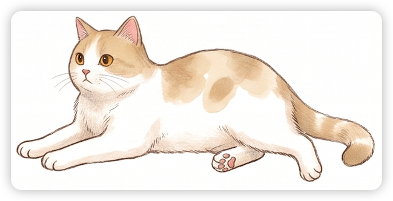

  

<h2 align="center">嗨，我是 skot 👋</h2>

  做<b>运维自动化</b>和<b>智能运维</b>相关的小工具。 
  喜欢做<b>小而顺手</b>的工具：打开就能用，不用装一堆东西。 
  <i>Building small tools for ops automation. I like tools that just work.</i>

---

### 🔭 现在关注 · Now

- **AIOps 智能运维** — 日志、指标、告警交给 AI 先过一遍：自动找异常、合并重复告警、让大模型写根因分析。
- **和 AI 一起做东西** — 用 Claude Code / Codex 当长期搭档：写代码、做测试、维护项目，把常用流程沉淀下来。
- **学英语** — 每天背单词、和外国朋友互相教中文和英语，顺手把学习工具也做出来。

### 🛠️ 正在构建 · Building

- **[cat-clock](https://github.com/skot-chen/cat-clock)** — 两只住在桌面上的猫，各自显示一个城市的时间，到点提醒「该打电话啦」。给相隔 7 小时的两个人用。Windows + macOS。

### 🐾 代表作品 · Projects

| 项目 | 一句话介绍 |
|---|---|
| **[OpenCodeCat](https://github.com/skot-chen/OpenCodeCat)** | 桌面上的一只像素小猫，顺手看一眼 AI 用量（5 小时 / 周 / 月）。 |
| **[bilingual-board](https://github.com/skot-chen/bilingual-board)** | 中英双语聊天板：自动翻译，英语错误用红笔标出来并用中文讲原因。 |
| **[daily-words](https://skot-chen.github.io/daily-words/)** | 每日单词网站：认词卡片 + 默写 + 间隔复习，手机电脑都能用。 |
| **[log-kb-lite](https://skot-chen.github.io/log-kb-lite/)** | 纯网页的日志分析工具：导入语料 → 关键字分类 → 分析 → 导出，数据不出浏览器。 |
| **[ticket-governance-demo](https://skot-chen.github.io/ticket-governance-demo/dashboard/)** | 工单治理工作流：字段标准化 → 三维分析 → KPI → 优先级矩阵 → PDCA 闭环。 |
| **[modelscope-balance](https://github.com/skot-chen/modelscope-balance)** | 用 Go 写的魔搭 API 负载均衡：多 Key 轮换、健康检查、实时统计。 |
| **[kaoyan-english2-plan](https://skot-chen.github.io/kaoyan-english2-plan/)** | 考研英语二 40 天真题背诵计划，网页版免安装。 |

### 🧰 常用工具 · Toolbox

`Python` · `Go` · `C#` · `JavaScript` · `Kubernetes` · `Prometheus` · `Docker` · `GitHub Pages` · `Claude Code`

### 📫 找到我 · Find me

[Blog](https://kuake.qzz.io) · [GitHub](https://github.com/skot-chen)

🐱 头像是「6 号猫」，一只淡紫三花。 · <i>The cat is "Cat No. 6", a lilac calico.</i>

